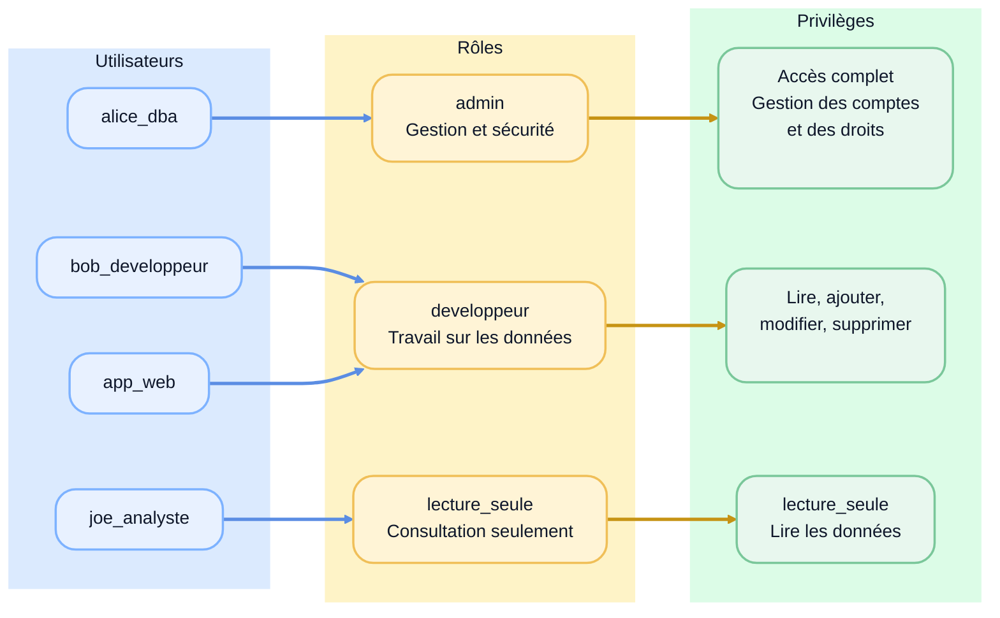

# 04 — Gestion de comptes et privilèges

## Objectif

Comprendre la différence entre **utilisateur**, **rôle** et **privilège** dans MariaDB, savoir attribuer des droits adaptés au contexte, puis vérifier que ces droits sont bien en place.

## L'essentiel à connaître

Dans MariaDB, on ne donne pas tous les droits à tout le monde.

Le bon réflexe est :

- donner seulement les droits nécessaires
- séparer les responsabilités
- éviter d'utiliser un compte trop puissant pour une application

## Structurer les accès

### Le modèle à retenir

Pour ne pas mêler les concepts, retenez ce modèle simple :

1. un **utilisateur** est une identité de connexion
2. un **rôle** sert souvent à regrouper des permissions
3. un **privilège** est un droit précis sur un objet précis

Dans MariaDB, les utilisateurs, les rôles et les privilèges sont des concepts distincts.

Le bon réflexe est donc :
- créer des utilisateurs pour les personnes et les applications
- créer des rôles pour représenter des fonctions comme `admin`, `developpeur`, `lecture_seule`
- attribuer les privilèges aux rôles
- ajouter ensuite les utilisateurs aux rôles



> On rattache des utilisateurs à des rôles, puis on accorde les privilèges aux rôles.

---

### Utilisateur, rôle, privilège

### Utilisateur

Un utilisateur est un compte qui peut se connecter à MariaDB.

```sql
create user 'bob'@'localhost'
identified by 'mot_de_passe_dev';
```

### Rôle

Un rôle sert à regrouper des privilèges.

On peut ensuite attribuer un ou plusieurs rôles à un utilisateur.

```sql
create role admin;
create role developpeur;
create role lecture_seule;

grant admin to 'alice'@'localhost';
grant developpeur to 'bob'@'localhost';
grant lecture_seule to 'joe_analyste'@'localhost';
```

### Privilège

Un privilège est un droit d'effectuer une action sur un objet MariaDB.

Exemples :

- `select`, `insert`, `update`, `delete` sur une table
- `create`, `alter`, `drop` sur des objets
- `execute` sur une procédure ou une fonction

---

### Qui devrait avoir quels droits

Il n'existe pas une seule réponse parfaite, mais certains profils reviennent souvent.

### Administrateur

Un administrateur peut typiquement :
- créer des rôles et des comptes
- accorder ou révoquer des privilèges
- gérer la structure
- intervenir sur la sécurité et la maintenance

On évite cependant d'utiliser ce compte pour les tâches normales de l'application.

### Développeur

Selon le contexte, un développeur peut :
- lire les données
- insérer, modifier ou supprimer certaines données
- parfois créer ou modifier des objets dans un environnement de développement

Mais il ne devrait pas automatiquement avoir tous les droits partout, surtout en production.

### Analyste ou lecteur

Un analyste ou un lecteur a souvent seulement besoin de :
- `connect` à la base de données
- `usage` sur le schéma
- `select` sur une à plusieurs tables

### Compte applicatif

Le compte utilisé par une application mérite une attention particulière.

Bonne pratique :
- lui donner uniquement les droits requis par l'application
- éviter `all privileges`
- éviter de lui permettre de modifier la structure
- éviter d'utiliser un compte administrateur dans la chaîne applicative

Exemple :
- une application de consultation peut n'avoir besoin que de `select`
- une application transactionnelle peut avoir besoin de `select`, `insert`, `update`, parfois `delete`

En cas d'injection SQL, ce compte ne pourra alors faire que ce qui lui est permis.

---

### Une manière simple d'organiser les accès

Une structure simple et claire ressemble souvent à ceci :

#### Utilisateurs

- `alice` : utilisateur réel
- `bob` : utilisateur réel
- `joe_analyste` : utilisateur réel
- `app_web` : utilisateur applicatif

#### Rôles

- `admin` : rôle de gestion de la base de données
- `developpeur` : rôle de travail sur les données
- `lecture_seule` : rôle de consultation

Puis :

- on donne les privilèges aux rôles
- on rattache les utilisateurs aux rôles

Exemple :

```sql
create user 'alice_admin'@'localhost'
identified by 'mot_de_passe_admin';

create user 'bob_dev'@'localhost'
identified by 'mot_de_passe_dev';

create user 'joe_analyste'@'localhost'
identified by 'mot_de_passe_lecture';

create user 'app_web'@'localhost'
identified by 'mot_de_passe_app';

create role admin;
create role developpeur;
create role lecture_seule;

grant admin to 'alice_admin'@'localhost';
grant developpeur to 'bob_dev'@'localhost';
grant lecture_seule to 'joe_analyste'@'localhost';
grant developpeur to 'app_web'@'localhost';
```

Cette approche est plus facile à maintenir que de gérer chaque utilisateur séparément.

## Gérer les privilèges avec `grant`

### Donner des droits sur les tables

```sql
grant select, insert, update, delete
on nom_de_la_bd.*
to developpeur;

grant select
on nom_de_la_bd.*
to lecture_seule;
```

### Donner des droits à un administrateur

```sql
grant all privileges
on nom_de_la_bd.*
to admin;
```

- `admin` n'est pas automatiquement un superutilisateur
- ces privilèges donnent un contrôle important sur les objets de la base

---

### Retirer des droits avec `revoke`

`revoke` sert à retirer un privilège ou un rôle.

```sql
revoke update
on nom_de_la_bd.employe
from developpeur;

revoke developpeur
from 'bob'@'localhost';

revoke all privileges
on nom_de_la_bd.employe
from lecture_seule;
```

Le principe reste le même :
- `grant` accorde
- `revoke` retire

---

### Quelques privilèges à connaître

Le tableau suivant résume les privilèges les plus utiles à retenir dans ce cours.
L'idée n'est pas de tout mémoriser, mais de reconnaître les plus fréquents.

| Privilège | S'applique surtout à | Permet essentiellement de |
| - | - | - |
| `SELECT` | table, vue | lire des données |
| `INSERT` | table | ajouter des lignes |
| `UPDATE` | table | modifier des lignes |
| `DELETE` | table | supprimer des lignes |
| `CREATE` | base de données, table | créer de nouveaux objets |
| `ALTER` | table | modifier la structure |
| `DROP` | table, base de données | supprimer un objet |
| `EXECUTE` | procédure, fonction | exécuter une routine |
| `ALL PRIVILEGES` | base ou objet | accorder tous les privilèges disponibles |

Source : [PostgreSQL Documentation — Privileges](https://www.postgresql.org/docs/current/ddl-priv.html)

## Valider les droits dans MariaDB

Voici quelques requêtes SQL simples que vous pouvez exécuter directement dans DBeaver.

### Voir les rôles

```sql
select host, user
from mysql.user
order by user;
```

### Voir quel utilisateur est actif

```sql
select current_user();
```

### Voir les bases de données

```sql
show databases;
```

### Voir les privilèges sur les tables

```sql
select grantee,
       table_schema,
       table_name,
       privilege_type
from information_schema.table_privileges
where table_schema = 'nom_de_la_bd'
order by grantee, table_name, privilege_type;
```

### Voir les privilèges sur une table précise

```sql
select grantee,
       table_schema,
       table_name,
       privilege_type
from information_schema.table_privileges
where table_schema = 'nom_de_la_bd'
  and table_name = 'client'
order by grantee, privilege_type;
```

### Tester avec un rôle précis

On peut vérifier quel rôle est actif dans la session courante.

```sql
select current_role();
```

Pour activer un rôle :

```sql
set role developpeur;
```

Puis vérifier le rôle actif :

```sql
select current_role();
```

On peut ensuite tester les opérations autorisées :

```sql
select * from employe;
```

## À retenir

- dans MariaDB, utilisateurs, rôles et privilèges sont des concepts distincts
- les rôles permettent de regrouper des privilèges et de simplifier l'administration
- le plus simple est de donner les privilèges à des rôles de groupe, puis d'y rattacher les utilisateurs
- il faut attribuer les droits selon le principe du moindre privilège
- les comptes applicatifs ne devraient pas avoir plus de droits que nécessaire
- `grant` accorde, `revoke` retire, et on peut vérifier le résultat avec SQL ou avec l'interface de DBeaver

---

### Sources

- [MariaDB Documentation — GRANT](https://mariadb.com/kb/en/grant/)
- [MariaDB Documentation — REVOKE](https://mariadb.com/kb/en/revoke/)
- [MariaDB Documentation — Roles Overview](https://mariadb.com/kb/en/roles_overview/)

---

<div class="my-6 rounded-lg border border-blue-300 bg-blue-50 p-4 text-blue-900">
	<strong class="block">ℹ️ À faire maintenant</strong>
	<p class="m-0">
		Passez au
		<a href="./../../labs/lab09-securite" class="font-semibold underline hover:text-blue-700">
			laboratoire 9 — Sécurité, comptes et privilèges
		</a>
		pour mettre en pratique la création de comptes, de rôles et l'attribution de privilèges dans Chinook.
	</p>
</div>
